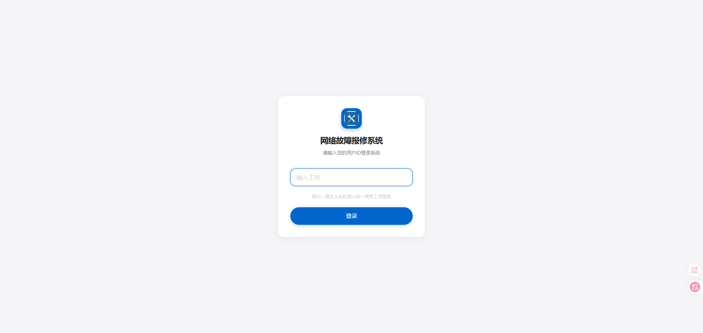
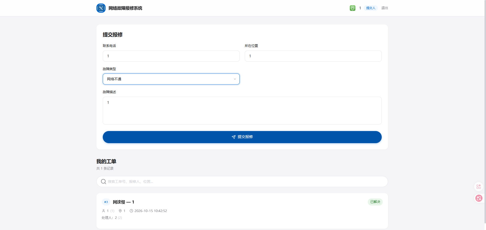
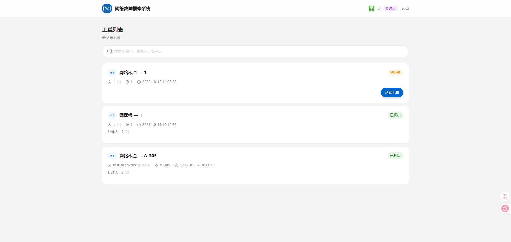
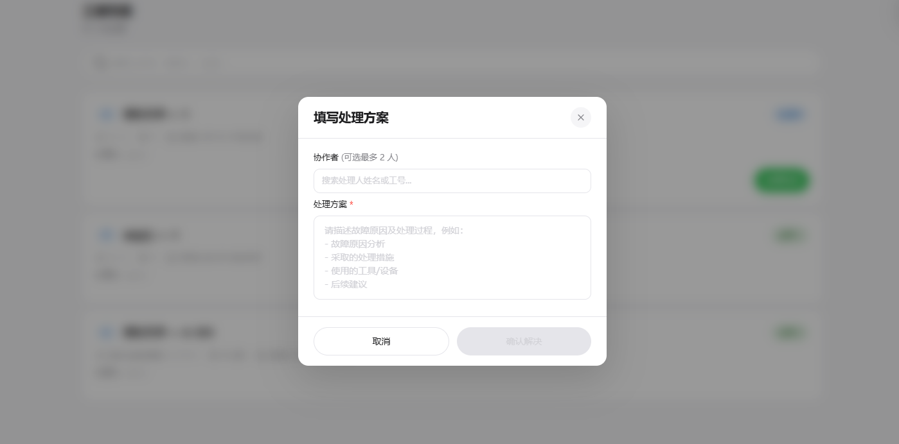
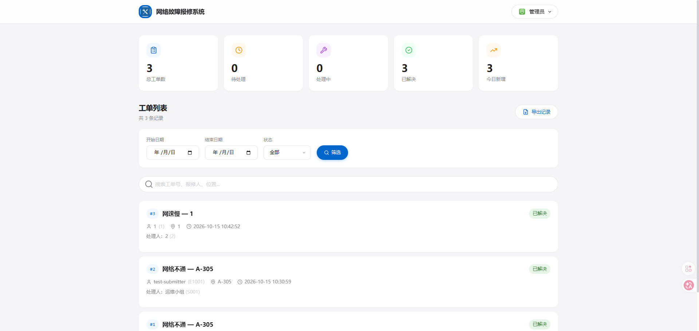
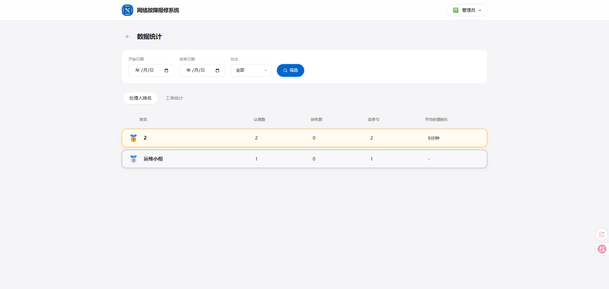
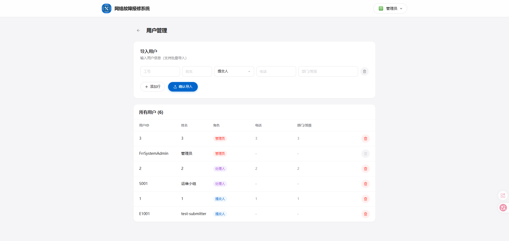
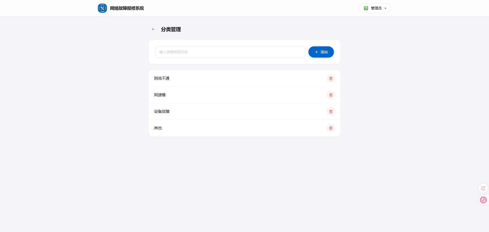

# 网络故障报修系统

   

内网部署的企业网络故障报修接单系统。提交人提交故障报修工单，处理人小组在线接单处理，管理员管理数据并导出报表。

## 功能

| 角色 | 功能 |
|------|------|
| 提交人 | 输入工号登录 → 提交报修 → 查看自己工单进度 |
| 处理人 | 输入工号登录 → 浏览待接单列表 → 接单 → 完成时可录入协作者（最多2人）→ 填写处理方案完成工单 |
| 管理员 | 输入工号登录 → 处理人排名 + 分类统计图表 + 趋势分析 + 日期/状态筛选 + 分页 + CSV导出 → 用户管理 → 故障类型管理 |


## 界面展示

### 登录

输入工号即可登录，无需密码，按角色进入对应界面。



### 提交人 — 提交报修

填写位置、故障类型与描述，一键提交报修工单。



### 处理人 — 接单与处理

处理人浏览待接单列表，认领工单；完成时可搜索并添加最多 2 名协作者，录入处理方案。





### 工单总览

工单卡片化展示，按状态（待处理/处理中/已完成）分区，支持搜索。



### 管理员 — 数据统计

处理人排名、故障分类统计、趋势分析，支持日期与状态筛选及 CSV 导出。



### 管理员 — 用户与分类管理

批量导入/删除用户、维护故障类型。




## 技术栈

| 层 | 技术 |
|---|---|
| 前端 | React 19 + TypeScript + Vite 7 + Tailwind CSS 3 + Recharts |
| 后端 | Python 3.8+ / Flask + PyJWT |
| 数据库 | SQLite |
| 认证 | JWT（无密码，仅校验工号/工号） |
| 安全 | HTML 标签剥离、输入长度限制、参数化查询 |
| i18n | 中文（可扩展英文） |

## 快速开始

### 环境要求

- Python 3.8+
- Node.js 20+

### 启动

```bash
# 终端1 - 后端
cd backend
pip install -r requirements.txt
python app.py                    # → http://localhost:5000

# 终端2（前端）
cd app
npm install
npm run dev                      # → http://localhost:3000
```

前端开发服务器已配置 `/api` 代理到 `http://localhost:5000`，无需额外 CORS 配置。

### 环境变量

后端支持 `.env` 配置（模板见 `.env.example`）：`ORG_NAME`（企业/机构名称）、`SECRET_KEY`、`DB_PATH`、`CORS_ORIGINS`、`LOG_LEVEL`、`LOG_BACKUP_COUNT`、`FLASK_DEBUG`、`ADMIN_USER_ID`（默认管理员账号）。

### 初始管理员

工号 `FrrSystemAdmin`，登录页直接输入即可进入管理员端。

## 使用流程

```
提交人提交报修 → 工单进入待接单池
                      ↓
处理人浏览列表 → 点击「认领」→ 状态变为「处理中」
                      ↓
处理人修完 → 填写处理方案 + 可选协作者 → 状态变为「已解决」
```

## 首次使用

1. 以管理员身份登录（工号 `FrrSystemAdmin`）
2. 点击顶栏名字 → 下拉菜单 →「用户管理」→ 逐行添加提交人和处理人
3. 点击顶栏名字 → 下拉菜单 →「分类管理」→ 添加故障类型
4. 导入后，提交人/处理人输入工号/工号即可登录

## 项目结构

```
├── app/                          # React 前端
│   ├── src/
│   │   ├── api/index.ts          # API 客户端（超时/错误处理）
│   │   ├── components/           # 通用组件（Header, TicketCard, StatsGrid, FilterBar, SearchBar, HandlerRanking, TicketStats 等）
│   │   ├── components/ui/        # shadcn UI 组件库
│   │   ├── hooks/useStore.ts     # 核心状态管理 + 登录持久化
│   │   ├── pages/                # 登录页、用户管理、分类管理、统计看板
│   │   ├── data/mockData.ts      # Mock 数据
│   │   ├── i18n/zh.ts            # 中文文案
│   │   ├── types/index.ts        # 类型定义
│   │   ├── config.ts             # USE_MOCK 开关
│   │   ├── App.tsx               # 主布局 + 路由
│   │   └── main.tsx              # 入口
│   ├── public/images/            # 静态资源（logo、头像）
│   ├── index.html                # HTML 入口（标题配置）
│   ├── vite.config.ts
│   └── package.json
├── backend/
│   ├── app.py                    # Flask 入口
│   ├── models.py                 # 数据库 + sanitize + seed
│   ├── auth.py                   # JWT 认证
│   ├── i18n.py                   # 后端多语言
│   ├── routes/
│   │   ├── tickets.py            # 工单 CRUD + CSV导出
│   │   ├── users.py              # 用户导入/列表/删除
│   │   ├── categories.py         # 故障类型 CRUD
│   │   └── stats.py              # 统计接口（排名/分类/趋势）
│   └── requirements.txt
├── tests/                        # pytest 自动化测试
├── docs/                         # 设计文档
├── scripts/                      # 工具脚本
├── DOCKER_DEPLOY.md              # Docker 部署指南
├── test/                         # 测试计划与记录文档
└── CHANGELOG.md                  # 更新日志
```

## Mock 模式

前端支持独立运行（无需后端）。修改 `app/src/config.ts`：

```ts
export const USE_MOCK = true;
```

Mock 模式下可使用测试账号：

| 账号 | 姓名 | 角色 |
|------|------|------|
| T001 | 李明 | 提交人 |
| S001 | 王芳 | 处理人 |
| FrrSystemAdmin | 管理员 | 管理员 |

## API 接口

### 认证
| Method | Path | 说明 |
|--------|------|------|
| POST | /api/auth/login | 登录，body: `{user_id}` → `{token, user}` |

### 工单
| Method | Path | 角色 | 说明 |
|--------|------|------|------|
| POST | /api/tickets | submitter | 提交报修 |
| GET | /api/tickets | 全部 | 列表（按角色返回不同范围，支持 `?start_date=&end_date=&status=`） |
| PUT | /api/tickets/:id/claim | handler | 接单 |
| PUT | /api/tickets/:id/complete | handler | 完成，body: `{solution, collaborator_ids?: string[]}`（协作者最多2人） |
| GET | /api/tickets/export | admin | CSV 导出，支持 `?start_date=&end_date=` |

### 用户
| Method | Path | 角色 | 说明 |
|--------|------|------|------|
| GET | /api/users | admin | 用户列表 |
| GET | /api/handlers | handler | 处理人列表（供协作者选择） |
| POST | /api/users/import | admin | 批量添加/更新，body: `{users: [...]}` |
| DELETE | /api/users/:id | admin | 删除用户（不删自己） |

### 故障类型
| Method | Path | 角色 | 说明 |
|--------|------|------|------|
| GET | /api/categories | 公开 | 故障类型列表 |
| POST | /api/categories | admin | 添加类型，body: `{name}` |
| DELETE | /api/categories/:id | admin | 删除 |

### 统计
| Method | Path | 角色 | 说明 |
|--------|------|------|------|
| GET | /api/stats/rankings | admin | 处理人排名（认领数/已解决/完成率/协作数/平均耗时） |
| GET | /api/stats/categories | admin | 故障类型分布（含数量和占比） |
| GET | /api/stats/trends | admin | 报修趋势（支持 `?interval=month\|week`） |

### 权限错误码
| 状态码 | 含义 |
|--------|------|
| 400 | 参数错误 |
| 401 | 未登录或凭证无效 |
| 403 | 无权限 |
| 404 | 资源不存在 |

## 部署到生产环境

> 完整部署指南详见 [Deploy.md](./Deploy.md)。Docker 单容器部署方案详见 [DOCKER_DEPLOY.md](./DOCKER_DEPLOY.md)。

### 前端

```bash
cd app
npm install
npm run build
# 将 dist/ 部署到 Nginx / IIS
```

**Nginx 参考配置：**

```nginx
server {
    listen 80;
    server_name _;

    root /opt/frr-system/app/dist;
    index index.html;

    location / {
        try_files $uri $uri/ /index.html;
    }

    location /api/ {
        proxy_pass http://127.0.0.1:5000;
        proxy_set_header Host $host;
        proxy_set_header X-Real-IP $remote_addr;
        proxy_set_header X-Forwarded-For $proxy_add_x_forwarded_for;
    }
}
```

**Windows IIS 部署：**

前端 `dist/` 目录作为 IIS 站点物理路径，需安装 URL Rewrite 模块并添加 SPA 回退规则（详见 `app/README.md`）。反向代理 `/api` 到后端需安装 ARR 模块。

### 后端

```bash
# Linux
cd backend
pip install -r requirements.txt
gunicorn -w 4 -b 0.0.0.0:5000 app:create_app()

# Windows（无法使用 gunicorn）
pip install waitress
waitress-serve --port=5000 app:create_app
```

## 前端自定义配置

| 配置项 | 文件 | 位置 |
|--------|------|------|
| 浏览器标题 | `app/index.html:6` | `<title>` 标签 |
| 登录页名称 | `app/src/i18n/zh.ts:2` | `appTitle` |
| 导航栏名称 | `app/src/components/Header.tsx:41` | span 文本 |
| 网站图标 | `app/public/` | 添加 favicon.ico + index.html 引用 |
| Logo | `app/public/images/logo.jpg` | 替换文件 |
| Mock 开关 | `app/src/config.ts` | `USE_MOCK` |

## 数据库备份与恢复

### Bash

```bash
# 备份
cp backend/data.db "backup_$(date +%Y%m%d_%H%M%S).db"

# 恢复
cp backup_xxx.db backend/data.db
```

### Windows PowerShell

```powershell
Copy-Item backend/data.db "backup_$(Get-Date -Format 'yyyyMMdd_HHmmss').db"
Copy-Item backup_xxx.db backend/data.db
```

### 定时备份（Linux cron）

```bash
0 3 * * * cp /path/to/backend/data.db /opt/backups/frr_$(date +\%Y\%m\%d_\%H\%M\%S).db && find /opt/backups -name '*.db' -mtime +1095 -delete
```

## 批量导入用户

用户批量导入通过后端内置 API 完成：POST /api/users/import（管理员 JWT，JSON 数组字段 `user_id`/`name`/`role`，示例见 `tests/`）。

## 开源说明

- **许可证**：本项目基于 [MIT License](./LICENSE) 开源
- **贡献**：参与开发请阅读 [CONTRIBUTING.md](./CONTRIBUTING.md)；角色命名与代码规范以其中说明为准
- **安全**：发现安全漏洞请勿公开 Issue，参见 [SECURITY.md](./SECURITY.md) 的报告流程与生产部署检查清单
- **Docker 一键部署**：项目根目录自带 `Dockerfile`、`nginx.conf`、`supervisord.conf`、`.dockerignore`，`docker build -t frr-system . && docker run -d -p 8080:80 -v frr-data:/app/data frr-system` 即可运行（详见 [DOCKER_DEPLOY.md](./DOCKER_DEPLOY.md)）
- **配置**：所有机构相关配置（企业名称、管理员账号、密钥）均通过 `.env` 注入，模板见 `.env.example`，仓库不含任何真实机构数据
- **隐私声明**：仓库中的姓名、账号、电话均为占位测试数据；如发现遗漏的真实信息，请提交 Issue，我们会立即处理
- **欢迎贡献**：Issue / PR 均可，欢迎提出安全加固、数据库迁移、多实例部署等方向的改进

## 文档索引

| 文档 | 内容 |
|------|------|
| [QUICK_INSTALLATION.md](./QUICK_INSTALLATION.md) | 5 分钟快速安装 |
| [DESIGN.md](./DESIGN.md) | 架构与数据模型设计 |
| [HANDOFF.md](./HANDOFF.md) | 交接文档 |
| [CHANGELOG.md](./CHANGELOG.md) | 更新日志 |
| [Deploy.md](./Deploy.md) | Linux 生产部署 |
| [DOCKER_DEPLOY.md](./DOCKER_DEPLOY.md) | Docker 部署 |
| [app/README.md](./app/README.md) | 前端详细说明 |